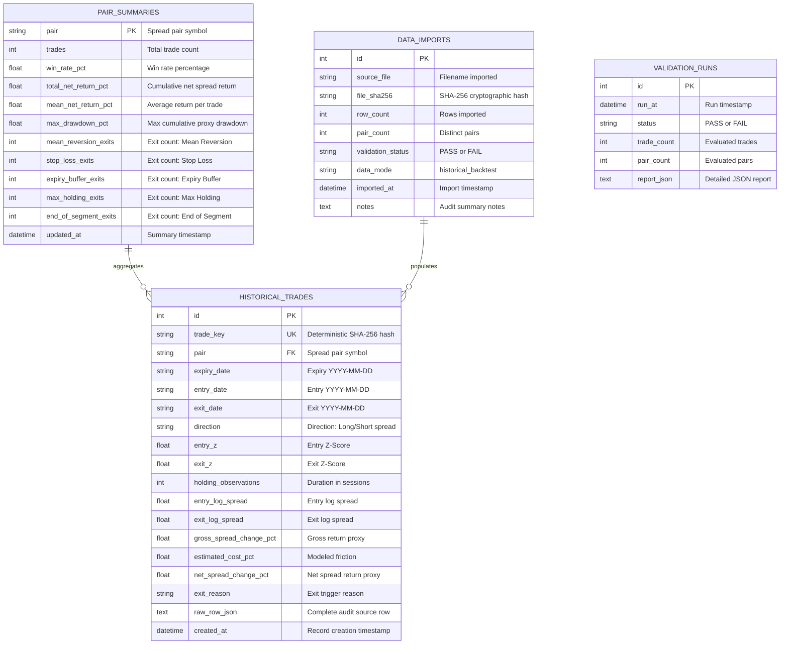

# SwarnaDrishti — Database Schema & Architecture

**Database Engine:** SQLite (local default) / PostgreSQL (production configurable via `DATABASE_URL`)  
**ORM:** SQLAlchemy 2.x  
**Default Path:** `backend/data/swarnadrishti.db`  

---

## 1. Entity Relationship Diagram (Mermaid)



---

## 2. Table Specifications

### Table: `historical_trades`
Stores the validated canonical trades imported from the walk-forward spread backtest.
* `id` (`INTEGER PRIMARY KEY AUTOINCREMENT`): Unique internal identifier.
* `trade_key` (`VARCHAR(64) UNIQUE NOT NULL`): Deterministic hash computed from `Pair`, `ExpiryDate`, `EntryDate`, `ExitDate`, `Direction`, and `NetSpreadChangePct`. Guarantees idempotency.
* `pair` (`VARCHAR(64) NOT NULL INDEX`): Contract pair (e.g., `GOLDGUINEA-GOLDPETAL`).
* `expiry_date` (`VARCHAR(16) NOT NULL`): Contract expiry date.
* `entry_date` (`VARCHAR(16) NOT NULL INDEX`): Trade entry date.
* `exit_date` (`VARCHAR(16) NOT NULL INDEX`): Trade exit date.
* `direction` (`VARCHAR(32) NOT NULL`): Trade posture (e.g., `Short A / Long B`).
* `entry_z` (`FLOAT NOT NULL`): Z-score on entry ($|z| < 4.0$).
* `exit_z` (`FLOAT NOT NULL`): Z-score on exit ($|z| \le 4.0$).
* `holding_observations` (`INTEGER NOT NULL`): Holding period in market sessions.
* `entry_log_spread` (`FLOAT NOT NULL`): Normalized log price differential at entry.
* `exit_log_spread` (`FLOAT NOT NULL`): Normalized log price differential at exit.
* `gross_spread_change_pct` (`FLOAT NOT NULL`): Gross spread return proxy.
* `estimated_cost_pct` (`FLOAT NOT NULL`): Modeled round-trip friction.
* `net_spread_change_pct` (`FLOAT NOT NULL`): Additive spread return proxy (percentage points).
* `exit_reason` (`VARCHAR(32) NOT NULL INDEX`): Cause for exit.
* `raw_row_json` (`TEXT`): Verbatim source row in JSON format.
* `created_at` (`DATETIME NOT NULL`): Ingestion timestamp.

### Table: `pair_summaries`
Maintains aggregate metrics dynamically derived from `historical_trades`.
* `pair` (`VARCHAR(64) PRIMARY KEY`): The spread pair identifier.
* `trades` (`INTEGER NOT NULL`): Total trade count.
* `win_rate_pct` (`FLOAT NOT NULL`): Percentage of profitable trades.
* `total_net_return_pct` (`FLOAT NOT NULL`): Additive sum of net spread return proxies.
* `mean_net_return_pct` (`FLOAT NOT NULL`): Mean net spread return proxy per trade.
* `max_drawdown_pct` (`FLOAT NOT NULL`): Peak-to-trough maximum drawdown of the additive proxy.
* `mean_reversion_exits` (`INTEGER NOT NULL DEFAULT 0`): Count of mean reversion exits.
* `stop_loss_exits` (`INTEGER NOT NULL DEFAULT 0`): Count of stop-loss exits.
* `expiry_buffer_exits` (`INTEGER NOT NULL DEFAULT 0`): Count of expiry buffer exits.
* `max_holding_exits` (`INTEGER NOT NULL DEFAULT 0`): Count of max holding duration exits.
* `end_of_segment_exits` (`INTEGER NOT NULL DEFAULT 0`): Count of end of segment exits.
* `updated_at` (`DATETIME NOT NULL`): Last derivation timestamp.

### Table: `data_imports`
Maintains an immutable audit ledger of file ingestion runs.
* `id` (`INTEGER PRIMARY KEY AUTOINCREMENT`)
* `source_file` (`VARCHAR(255) NOT NULL`)
* `file_sha256` (`VARCHAR(64) NOT NULL INDEX`)
* `row_count` (`INTEGER NOT NULL`)
* `pair_count` (`INTEGER NOT NULL`)
* `validation_status` (`VARCHAR(32) NOT NULL`)
* `data_mode` (`VARCHAR(64) NOT NULL DEFAULT 'historical_backtest'`)
* `imported_at` (`DATETIME NOT NULL`)
* `notes` (`TEXT`)

### Table: `validation_runs`
Audit history of mathematical and domain guard checks.
* `id` (`INTEGER PRIMARY KEY AUTOINCREMENT`)
* `run_at` (`DATETIME NOT NULL`)
* `status` (`VARCHAR(32) NOT NULL`)
* `trade_count` (`INTEGER NOT NULL`)
* `pair_count` (`INTEGER NOT NULL`)
* `report_json` (`TEXT NOT NULL`)

---

## 3. Database Management Commands

### Initialize Schema
```bash
py -c "from db.session import init_db; init_db()"
```

### Import Canonical Data Idempotently
```bash
py importer.py --file data/walk_forward_spread_trades.csv
```
